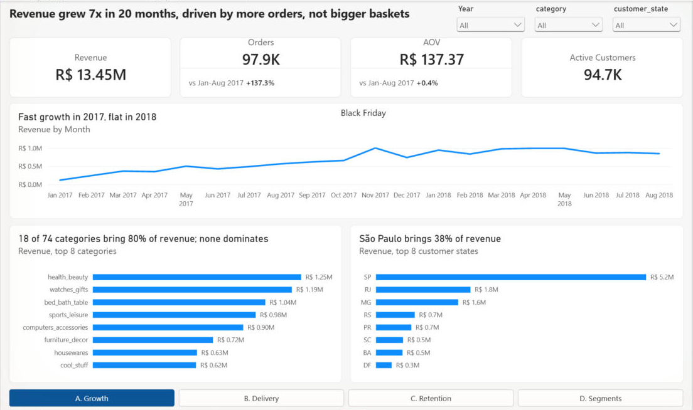
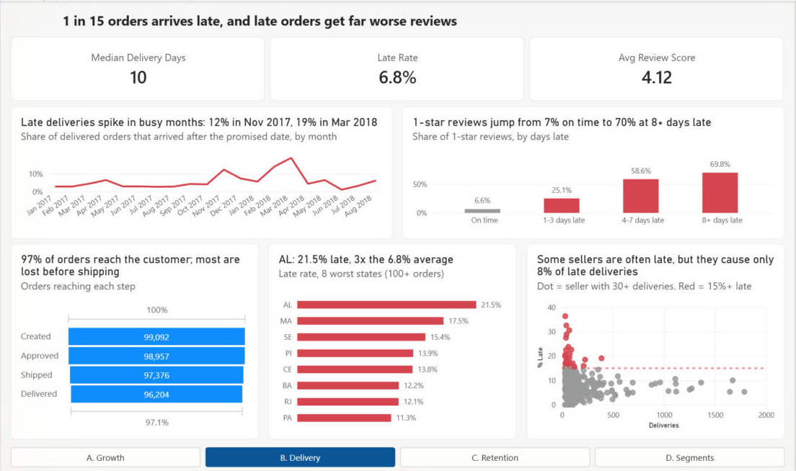
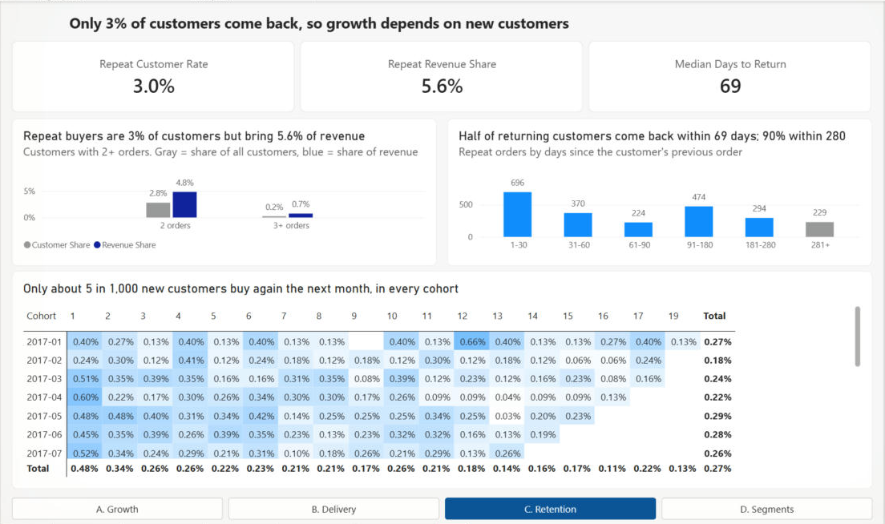
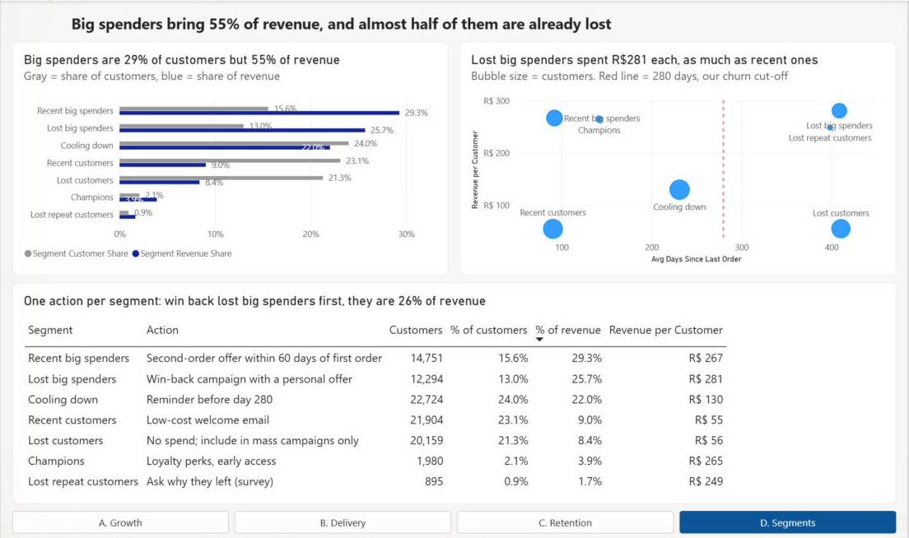

# Olist E-Commerce: Growth, Delivery and Customer Retention

An analysis of about 100,000 orders from Olist, a Brazilian online marketplace, in SQL Server and Power BI.

## Business problem

Olist's monthly revenue grew about 7x from January 2017 to August 2018, but growth slowed in 2018. Management needs to know where the next growth should come from: new customers, existing customers, or fixing the problems that drive customers away.

| | Question |
|---|---|
| **A** | Are we growing, and where does growth come from? |
| **B** | Are we delivering what we promised? |
| **C** | Do customers come back? |
| **D** | Which customers should we focus on? |

## Data

[Brazilian E-Commerce Public Dataset by Olist](https://www.kaggle.com/datasets/olistbr/brazilian-ecommerce) (Kaggle): orders from September 2016 to October 2018, amounts in Brazilian real (BRL). Eight tables are used: orders, order items, payments, reviews, customers, products, sellers and category names.

## Approach

1. **Check** the data: keys, links between tables, missing and invalid values, period, outliers, consistency.
2. **Clean** it in SQL views. The raw tables are never changed; problem records are flagged, not deleted.
3. **Analyse** questions A to D in SQL.
4. **Build** a Power BI dashboard with one page per question, and check every number against SQL.
5. **Recommend** actions based on the findings.

| File | Content |
|---|---|
| `sql/01_create_tables.sql` | Database and tables |
| `sql/02_data_checks.sql` | Data checks |
| `sql/03_clean_views.sql` | Clean views used by every analysis |
| `sql/04_kpi_analysis.sql` | A. Growth |
| `sql/05_operations.sql` | B. Delivery |
| `sql/06_cohort_retention.sql` | C. Retention |
| `sql/07_rfm.sql` | D. Customer segments |
| `sql/08_powerbi_views.sql` | Result tables for Power BI |
| `powerbi/Olist_dashboard.pbix` | Dashboard |
| `docs/decision_log.md` | Every check and rule, with the reasoning |

## Main rules

| Topic | Rule |
|---|---|
| Customer | A person is `customer_unique_id`; Olist creates a new `customer_id` for every order |
| Period | Trends use January 2017 to August 2018; the months before and after are almost empty |
| Revenue | Sum of item prices, without freight |
| Sale | Every order except canceled and unavailable ones |
| Late delivery | Delivered after the estimated date |

## Findings

> **Olist grew fast but does not keep its customers.** Growth comes almost entirely from new customers, only 3% buy twice, and late deliveries are linked to much worse reviews.

### A. Growth

- Monthly revenue grew from 120K to 849K BRL. Growth came from more orders (+137%), not bigger baskets (+0.4%).
- In 2018 revenue stayed flat; year-over-year growth fell from +687% to +49%.
- 18 of 74 categories bring 80% of revenue. São Paulo brings 38%.

### B. Delivery

- 6.8% of orders arrive late, rising to 12-19% in busy months.
- 1-star reviews rise from 6.6% for on-time orders to 69.8% for orders 8+ days late.
- Sellers that are often late cause only 8% of late deliveries. The problem is regional (AL 21.5%, MA 17.5%), not a few bad sellers.

### C. Retention

- Only 3% of customers buy more than once; they bring 5.6% of revenue.
- One month after the first order, only about 5 in 1,000 customers buy again, and this has not improved over time.
- Half of returning customers come back within 69 days, 90% within 280 days.

### D. Customer segments

- Big spenders bring 55% of revenue.
- Lost big spenders (no order for 280+ days) are 13% of customers but 25.7% of revenue.

## Recommendations

| # | Recommendation | How to measure |
|---|---|---|
| 1 | Encourage a second order within 60 days of the first one | Repeat rate within 90 days, against a control group |
| 2 | Before busy months, add carrier capacity or add buffer days to the delivery estimate | Late rate and 1-star share in the next busy months |
| 3 | Fix late deliveries by region and carrier, starting with Rio de Janeiro and the north-east | Late rate by state |
| 4 | Win-back campaign for lost big spenders | Return rate, against a control group |

## Limitations

- There is no cost or website traffic data, so profit and the effect of the recommendations cannot be calculated; they should be tested first.
- The links found (for example, late delivery and low reviews) are correlations, not proven causes.
- The data ends in August 2018, so recent customers are observed for a short time.

## How to reproduce

1. Download the dataset from [Kaggle](https://www.kaggle.com/datasets/olistbr/brazilian-ecommerce) into `data/raw/`.
2. Run `sql/01_create_tables.sql` in SQL Server 2022 and load each CSV into the table with the same name.
3. Run the other SQL files in order.
4. Open `powerbi/Olist_dashboard.pbix` and point the data source to your SQL Server.
