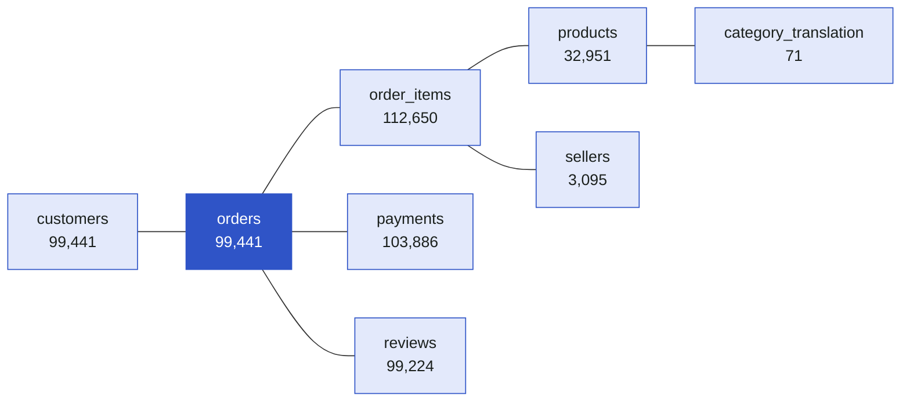
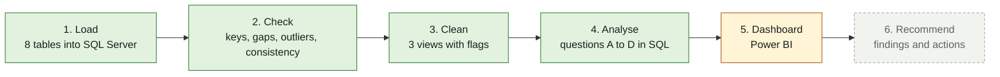

# Olist E-Commerce: Growth, Delivery and Customer Retention

An end-to-end analysis of about 100,000 orders from Olist, a Brazilian online marketplace, in SQL Server (and Power BI, in progress). It answers four business questions: is the company growing, is it delivering on time, do customers come back, and which customers deserve attention.

> [!NOTE]
> **Status:** data checks, cleaning and the SQL analysis are complete. The Power BI dashboard and the final recommendations are in progress.

## Contents

1. [Introduction](#introduction)
2. [Business questions](#business-questions)
3. [Dataset](#dataset)
4. [Approach](#approach)
5. [Data checks and cleaning](#data-checks-and-cleaning)
6. [Key findings](#key-findings)
7. [Repository structure](#repository-structure)
8. [How to reproduce](#how-to-reproduce)
9. [Limitations](#limitations)

---

## Introduction

Olist connects small Brazilian shops to large online marketplaces. A customer places one order, which can contain products from several sellers; Olist handles payment, and the sellers ship the products through logistics partners. After delivery, the customer is asked to leave a review.

The analysis starts from a question a manager would ask:

> **"Are we growing? Do our customers come back? Which customers and which problems should we focus on?"**

## Business questions

| | Question | Sub-questions |
|---|---|---|
| **A** | Are we growing, and where does growth come from? | Monthly revenue, orders and average order value; month-over-month and year-over-year growth; categories; states |
| **B** | Are we delivering what we promised? | Order funnel; delivery time; late deliveries and review scores; states; sellers |
| **C** | Do customers come back? | Repeat purchase rate; cohort retention; time to the second order; effect of the first experience |
| **D** | Which customers should we focus on? | RFM segmentation and an action for each segment |

## Dataset

[Brazilian E-Commerce Public Dataset by Olist](https://www.kaggle.com/datasets/olistbr/brazilian-ecommerce) (Kaggle). Orders from September 2016 to October 2018, amounts in Brazilian real (BRL). Eight of the nine tables are used; the geolocation table is not needed for these questions.



Every table links to `orders` through `order_id`. One order can have several items, several payments and, rarely, several reviews, which is why tables are summarised to one row per order before they are joined.

## Approach



| File | Content |
|---|---|
| `sql/01_create_tables.sql` | Database, tables, indexes and a row count check against the CSV files |
| `sql/02_data_checks.sql` | Data checks: keys, links, missing and invalid values, period, outliers, consistency |
| `sql/03_clean_views.sql` | Analysis-ready views with flags for sales, the analysis window and valid deliveries |
| `sql/04_kpi_analysis.sql` | A. Growth: monthly revenue, orders, AOV, MoM and YoY, categories, states |
| `sql/05_operations.sql` | B. Delivery: funnel, delivery time, late deliveries and reviews, states, sellers |
| `sql/06_cohort_retention.sql` | C. Retention: repeat customers, cohorts, time to the second order, first experience |
| `sql/07_rfm.sql` | D. Customer segments with RFM |
| `sql/08_powerbi_views.sql` | Result views for Power BI: sellers, cohorts, repeat-order gaps, RFM segments |
| `powerbi/Olist_dashboard.pbix` | Dashboard: A. Growth, B. Delivery, C. Retention and D. Segments pages |

Every query in the files is followed by its result and a short interpretation.

## Data checks and cleaning

Before any analysis, the data was checked for keys, links between tables, missing and invalid values, the period covered, outliers and consistency.

> [!IMPORTANT]
> The data is reliable: problems are small and appear in specific places. The raw tables are never changed. Cleaning rules live in three views, and problem records are flagged, not deleted, so each measure uses only the orders that are valid for it.

| View | One row = | Rows | Used for |
|---|---|---:|---|
| `vw_orders` | one order | 99,441 | growth, delivery, reviews |
| `vw_order_items` | one order item | 112,650 | categories, sellers, revenue |
| `vw_customers` | one person | 96,096 | retention, segmentation |

The main rules:

| Topic | Rule |
|---|---|
| Customer | A person is `customer_unique_id`: Olist creates a new `customer_id` for every order |
| Period | Trends use January 2017 to August 2018; the months before and after are almost empty |
| Revenue | Sum of item prices, without freight |
| Sale | Every order except canceled and unavailable ones |
| Late delivery | Delivered after the estimated date, compared as dates (the estimate has no time) |
| Review score | One score per order: the newest review |

Every check, finding and rule, with the reasoning behind it: **[docs/decision_log.md](docs/decision_log.md)**

## Key findings

> [!IMPORTANT]
> **Olist grew fast but does not keep its customers.** Almost all growth comes from new customers, only 3% buy twice, and late deliveries are linked to both lower review scores and fewer returning customers.

### A. Are we growing?

| Measure | Result |
|---|---|
| Monthly revenue | About **7x** from January 2017 (120K BRL) to August 2018 (849K BRL) |
| Source of growth | Orders **+137%**, average order value **+0.4%** (Jan-Aug 2018 vs 2017) |
| Growth speed | Year-over-year growth fell from **+687%** (Jan 2018) to **+49%** (Aug 2018) |
| Categories | **18 of 74** categories bring 80% of revenue; the largest is only 9% |
| States | São Paulo brings **38%** of revenue but has the lowest revenue per customer (130 BRL) |

- Growth came from more orders, not bigger baskets. In 2018 monthly revenue stayed flat at 840K-990K BRL: growth continues but is slowing.
- The November 2017 peak is Black Friday. The −26% month-over-month in December is not a drop, only a comparison with that peak.

### B. Are we delivering what we promised?

| Measure | Result |
|---|---|
| Orders that reach the customer | **97.1%**; the largest loss is between payment approval and shipping (1,581 orders) |
| Delivery time | Median **10 days**; 1 in 10 orders takes more than 23 days |
| Late deliveries | **6.8%**, rising to **12-19%** in November 2017, February and March 2018 |
| Late orders with 1-star reviews | **53.8%**, against 6.6% for on-time orders (**8x**) |
| Worst sellers' share of late deliveries | The 39 sellers with 15%+ late rates cause only **8%** of all late deliveries |

| Delay | Average score | 1-star share |
|---|---:|---:|
| On time | 4.29 | 6.6% |
| 1-3 days late | 3.29 | 25.1% |
| 4-7 days late | 2.10 | 58.6% |
| 8+ days late | 1.70 | 69.8% |

- The score falls at every step of delay. This is a correlation, not proof of cause, but the steady pattern makes the link convincing.
- Late deliveries are concentrated in the north-east (AL 21.5%, MA 17.5%). By number of customers affected, the priority is Rio de Janeiro: 12.1% late and about 1,490 late orders.
- Lateness is spread across many sellers, so the fix lies in logistics and delivery estimates, not in a few bad sellers.

### C. Do customers come back?

| Measure | Result |
|---|---|
| Customers who bought more than once | **3%**, bringing 5.6% of revenue |
| Cohort retention, one month later | **0.48%** on average: about 5 in 1,000 new customers |
| Time to the second order | Median **69 days**, 90% within **280 days** (used as the churn threshold) |
| Customers whose first order was late | Came back about **one third less often** (1.99% vs 2.93%) |

- Cohorts grew 9x over 20 months, but retention rates did not improve.
- 29% of repeat orders came on the same day as the previous order: a split shopping session, not a customer coming back. They are excluded from the time-to-return measures.

### D. Which customers should we focus on?

| Segment | Customers | Revenue | Status |
|---|---:|---:|---|
| Recent big spenders | 15.6% | **29.3%** | Active |
| Lost big spenders | 13.0% | **25.7%** | No order for 280+ days |
| Cooling down | 24.0% | 22.0% | Inactive, not yet lost |
| Recent customers | 23.1% | 9.0% | Active |
| Lost customers | 21.3% | 8.4% | Lost |
| Champions (2+ orders, active) | 2.1% | 3.9% | Active |
| Lost repeat customers | 0.9% | 1.7% | Lost |

- Big spenders bring 55% of revenue, but almost half of that revenue comes from customers already lost.
- The first group to protect is the recent big spenders (about 14,750 people), in the two months after their first order.

## Repository structure

```
ecommerce-sales-analysis/
├── README.md
├── docs/
│   └── decision_log.md      data checks, findings and cleaning rules
├── sql/
│   ├── 01_create_tables.sql
│   ├── 02_data_checks.sql
│   ├── 03_clean_views.sql
│   ├── 04_kpi_analysis.sql
│   ├── 05_operations.sql
│   ├── 06_cohort_retention.sql
│   ├── 07_rfm.sql
│   └── 08_powerbi_views.sql
├── powerbi/
│   └── Olist_dashboard.pbix
└── data/raw/                CSV files (not stored in the repo)
```

## How to reproduce

1. Download the dataset from [Kaggle](https://www.kaggle.com/datasets/olistbr/brazilian-ecommerce) into `data/raw/`.
2. Run `sql/01_create_tables.sql` in SQL Server 2022 to create the database and tables.
3. Load each CSV into the table with the same name (SSMS Import Flat File) and run the row count check at the end of the script.
4. Run the remaining scripts in order. `03_clean_views.sql` must run before the analysis scripts.
5. Open `powerbi/Olist_dashboard.pbix` in Power BI Desktop and point the data source to your SQL Server (Transform data → Data source settings).

## Limitations

- **No cost data:** revenue can be measured, profit cannot.
- **Observational data:** links such as late delivery and low scores are correlations, not proven causes.
- **Data ends in August 2018:** recent customers and cohorts are observed for a short time (right censoring).
- **Reviews are optional:** satisfaction is measured only on reviewed orders.
- **Vouchers** are recorded as a payment method; whether they are discounts is unknown, so they are not deducted from revenue.
