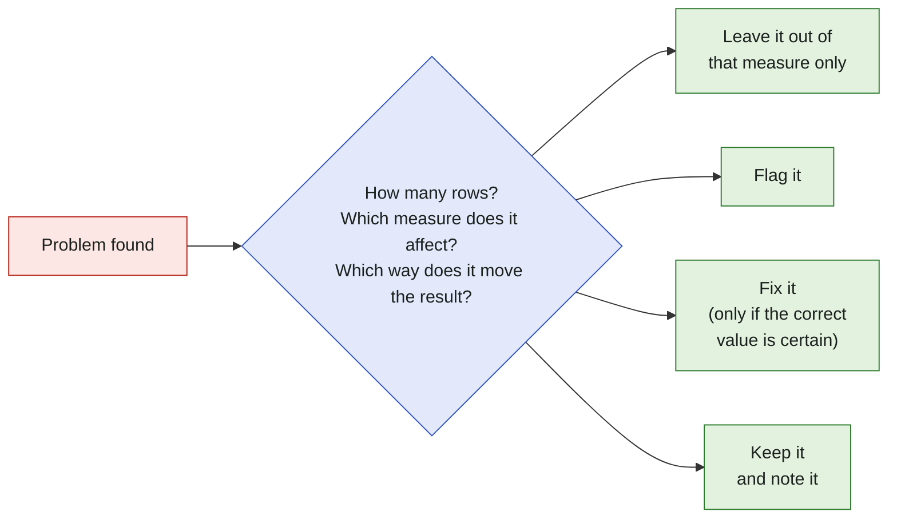

# Data Checks and Decisions

Before answering any business question, the data was checked to see how far it can be trusted. This page explains **what was checked, what was found and what was decided**.

Every decision is written in three parts: **what** was decided, **why**, and **what it changes**. You don't need a data background to follow them. The *Technical detail* sections are for analysts. The queries are in [`sql/02_data_checks.sql`](../sql/02_data_checks.sql).

> [!IMPORTANT]
> **Verdict: the data is reliable for this analysis.**
> The problems found are small (each under 1% of orders) and appear in specific places. No raw data is deleted. Problem records are flagged and left out only of the measures they would distort.

---

## At a glance

| | Check | Question | Result | |
|---|---|---|---|:---:|
| 🔑 | **Keys** | What makes each row unique? | Every table has a clear key | ✅ |
| 🔗 | **Links** | Do the tables match each other? | 775 orders have no items; almost all were canceled or unavailable | ✅ |
| ⬜ | **Missing values** | Where are values missing, and why? | Missing dates follow the order journey: canceled orders never get a delivery date | ✅ |
| 🚫 | **Invalid values** | Are the values possible? | 3 payments of 0 with the type "not_defined" | ⚠️ |
| 📅 | **Period** | Which months are complete? | The first and last months have very few orders | ⚠️ |
| 📈 | **Outliers** | Are extreme values real? | Yes: expensive items are real, delivered purchases | ✅ |
| ⚖️ | **Consistency** | Do the tables agree with each other? | Payments match item totals in 99.75% of orders | ✅ |

✅ no action needed&nbsp;&nbsp;&nbsp;⚠️ handled by a decision below

---

## How a problem is handled

Deleting a record is never the first answer. A record can be wrong for one measure and still correct for another: an order with a missing delivery date cannot be used for delivery time, but it is still a real sale.

---

## Key terms

| Term | Meaning in plain words |
|---|---|
| **Row (grain)** | What one line of a table stands for: one order, one item in an order, one payment |
| **Key** | The column, or pair of columns, that tells rows apart |
| **Fan-out** | When joining tables makes rows repeat, so totals are counted more than once |
| **Median** | The middle value: half of the values are below it, half above. Unlike the average, a few extreme values cannot pull it up |
| **Analysis window** | The months used for trends over time |

---

## Decisions

### 1. 👤 A customer is a person, not a customer ID

| | |
|---|---|
| **What** | Customers are counted with `customer_unique_id`. |
| **Why** | Olist creates a new `customer_id` for every order. The 99,441 customer IDs belong to **96,096 people**. |
| **What it changes** | Counted by `customer_id`, every customer would look like a one-time buyer and the repeat-purchase rate would be 0%. |

Technical detail

`customers` has one row per order (`customer_id` is 1:1 with `orders`). `customer_unique_id` is the person. `customer_id` is used only to join `orders` to `customers`.

### 2. 📅 Trends over time use January 2017 to August 2018

| | |
|---|---|
| **What** | Monthly trends and growth rates use the 20 months from January 2017 to August 2018. |
| **Why** | The data runs from September 2016 to October 2018, but the edges are almost empty. November 2016 has no orders, December 2016 has 1, and September and October 2018 have 20 orders together, almost all canceled. Going from 1 order to 800 would show as **+79,900% growth**, which is not real. |
| **What it changes** | 349 orders (0.35%) fall outside the window. They stay in the data and are left out only of time trends. |

> [!NOTE]
> November 2017 has the highest number of orders (7,544, about 60% more than October). This is Black Friday, a real business event, so it is kept and explained in the charts, not removed.

Technical detail

`GROUP BY` month only shows months that have orders, so an empty month would simply be missing. A recursive CTE first builds the full list of months, then the monthly counts are joined to it with a `LEFT JOIN` and `COALESCE(orders, 0)`.

### 3. 📈 Extreme values are kept; the typical value is the median

| | |
|---|---|
| **What** | Very expensive items are kept. Typical values are reported with the median; totals (revenue, average order value) use the sum and the average. |
| **Why** | The most expensive items are computers, appliances, art, instruments and consoles, and all of them were delivered. They are real purchases, not errors. |
| **What it changes** | A few large values pull the average up, so the average alone would overstate the typical purchase. |

| Measure (BRL) | Median | Average | Highest |
|---|---:|---:|---:|
| Item price | 75 | 121 | 6,735 |
| Freight | 16 | 20 | 410 |
| Payment | 100 | 154 | 13,664 |

Technical detail

All three measures are right-skewed (average > median). SQL Server has no `MEDIAN()` function, so the median is computed with `PERCENTILE_CONT(0.5) WITHIN GROUP (ORDER BY ...) OVER ()`.

### 4. ⏱️ Orders with conflicting dates are kept, but left out of the measures they distort

| | |
|---|---|
| **What** | Orders whose dates are out of order, or do not match their status, stay in the data and are flagged. |
| **Why** | The conflicts affect single steps, not the whole order. No order was delivered before it was placed, so total delivery time is always valid. |
| **What it changes** | These orders are left out of step-by-step durations (for example, approval to carrier). The 8 delivered orders without a delivery date are left out of delivery time, but still count as sales. |

| Conflict | Orders |
|---|---:|
| Handed to the carrier before approval | 1,359 |
| Delivered before being handed to the carrier | 23 |
| Status "delivered" but a date is missing | 24 |
| Status "canceled" but has a delivery date | 6 |
| Delivered before purchase | **0** |

### 5. 🗄️ Loading choices

| What | Why |
|---|---|
| Zip codes and IDs are stored as text | They are labels, not amounts. As numbers, `01310` would become `1310`. |
| The geolocation table is not loaded | The analysis does not use exact location; customer city and state are already in the `customers` table. |
| A header row in the category translation table was removed | It had been loaded as a data row (72 rows instead of 71 categories). |

---

## Open items

Smaller findings and how they are planned to be handled in the analysis.

| Finding | Size | Planned handling |
|---|---|---|
| Orders without any item | 775 orders | No sales value; they do not appear in item-based measures |
| Orders without a payment | 1 order | Ignored |
| Orders without a review | 768 orders | Reviews are optional; satisfaction is measured on reviewed orders only |
| Orders with more than one review | 551 rows | One score per order is needed; a rule (for example, the latest review) will be chosen |
| Reviews without a text message | 58.7% of reviews | Satisfaction is measured with the review score, not the text |
| Products without a category | 610 products | Labelled "unknown" |
| Categories without an English name | 2 categories, 13 products | The Portuguese name is shown |
| Payment type "not_defined" | 3 payments, all 0 | Left out of payment-type analysis |

> [!TIP]
> **Revenue** will be measured as the sum of item prices (`SUM(price)`), without freight. Item totals and payments match in 99.75% of orders, so this definition is supported by both tables.
